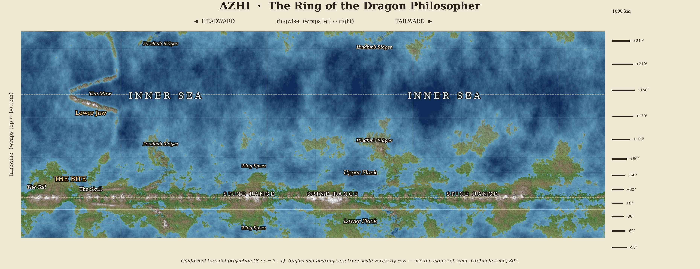

# Azhi Campaign

A D&D 5e setting on a ring-shaped world, the corpse of Azhi, the philosopher dragon who ate itself.

- **Claude, start here:** `CLAUDE.md`
- **Plan and checklist:** `PLAN.md`
- **Setting facts:** `canon/setting-bible.md` · **Decisions:** `canon/decisions.md` · **Myth:** `canon/azhi-myth.md`
- **Maps:** `worldgen/` · **Art:** `art/` · **Rules (from Phase 1):** `srd/`

## Repository

Hosted privately on GitHub at `jiilik/azhi-campaign`. Claude sessions attach it through the GitHub connection in claude.ai settings, with the Claude GitHub App limited to this one repository. Never paste tokens or passwords into a chat.

## Claude Project

See `project-instructions.md` for the custom-instructions text and the list of knowledge files.
